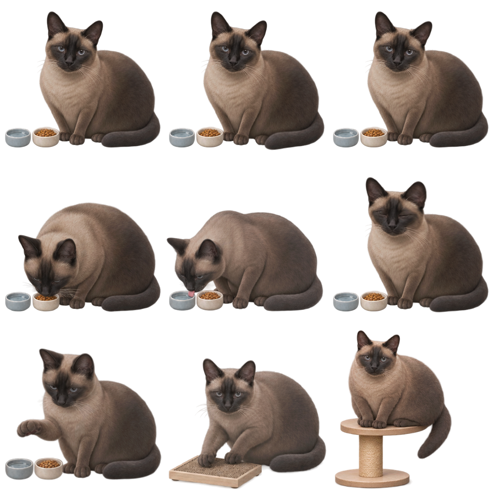

# 包包桌面摆件 V1.0

一只半写实的 Windows 桌面暹罗猫。包包十岁，大骨架、胖身体，会眨眼、动耳朵和尾尖，也会陪你吃饭、喝水和玩耍。

**朋友试用请到 [Releases 下载运行包](https://github.com/baotu4/baobao-desktop/releases/latest)**，完整解压后双击 `Baobao.exe`，保留同目录的 `Baobao.exe.config`。不需要下载源码或安装开发工具。



## 操作

| 操作 | 效果 |
| --- | --- |
| 在头或上背长按约半秒，再轻轻来回移动 | 抚摸：渐闭眼、侧头轻蹭、尾尖摆动、单耳轻转和轻微呼吸 |
| 按住 Alt，再左键拖动 | 移动摆件 |
| 滚轮 | 调整大小 |
| 右键 → 陪玩 | 在包包附近移动光点约 6–8 秒，观察注视与伸爪 |
| 把普通文件拖到双碗 | **真实移入系统回收站**，成功后随机吃粮或喝水 |
| 把专用玩具 PNG 拖到猫身 | 播放抓板或爬架互动，玩具文件保留原位 |
| Esc | 取消当前互动 |
| 托盘猫头像 | 显示、隐藏、关闭鼠标穿透或退出 |

初次投喂请用专门创建的测试文本。普通文件和玩具分开投放。V1.0 接收本地固定盘的普通文件，文件夹、网络盘、移动介质及受保护路径按规则拒收。

约十分钟没有互动时，会出现吃饭、喝水、摸摸或陪玩的轻量气泡；右键“少说话”可关闭自发诉求。

## 构建与检查

目标环境：Windows x64、.NET Framework 4.8。使用系统自带 C# 编译器，无 NuGet 依赖。

```powershell
powershell -NoProfile -ExecutionPolicy Bypass -File .\build.ps1
```

生成 `bin\Baobao.exe` 和配置文件。全部素材和头像图标已包含在仓库中。

```powershell
powershell -NoProfile -ExecutionPolicy Bypass -File .\Run-Tests.ps1
powershell -NoProfile -ExecutionPolicy Bypass -File .\Run-Tests.ps1 -NativeChecks
```

`-NativeChecks` 会先构建本仓库产品，再运行隐藏窗口集成检查；其中真实回收仅使用测试自己创建的文件，不清空回收站。

## 试用反馈与后续迭代

遇到问题可 [提交 Issue](https://github.com/baotu4/baobao-desktop/issues/new/choose)，或按 [反馈模板](docs/PLAYTEST.md) 记录发生场景、复现步骤、Windows 版本和缩放比例。

V1.0 已包含猫抓板、简单柱形猫爬架；玩具类型与动作接口保留，后续在这个版本上继续迭代。当前玩具为短场景互动，结束后回到双碗待机。

更多内容：[验证范围](docs/TESTING.md) · [开发约定](开发约定.txt) · [美术提示词](prompts/)
